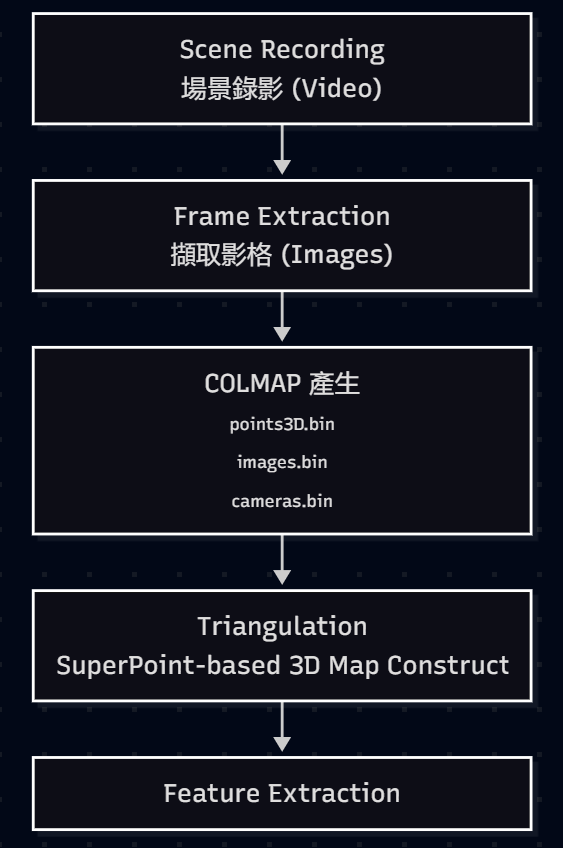
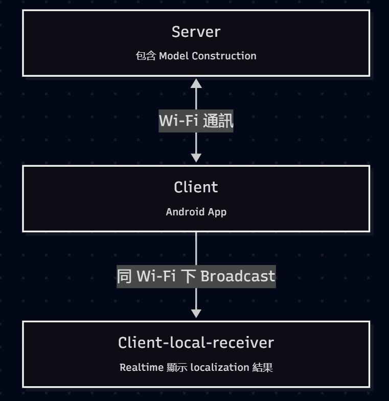
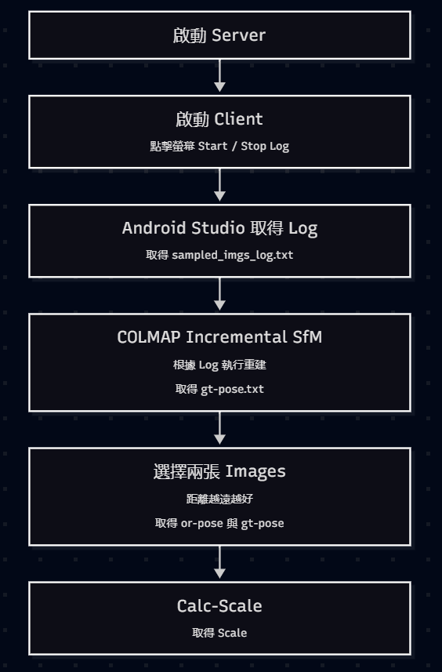

# CollabLoc

本專案基於 [Hierarchical Localization (hloc)](https://github.com/cvg/Hierarchical-Localization) 修改，用於場景三維建模、視覺定位、ARCore 位姿融合及定位評估。

- hloc 原始說明：[README_hloc.md](README_hloc.md)
- 第三方程式碼來源：[THIRD_PARTY.md](THIRD_PARTY.md)

## 交接文件

完整操作說明、詳細參數、截圖及 Google Drive 資源連結請參考：

- [Model Construction（建模）](https://hackmd.io/JceIab7qRaKnvgWgD4Y43Q)
- [Localization（定位與評估）](https://hackmd.io/vKDh_zrtSI2s_9SjZA6vaw)

本 README 為操作流程摘要。若與交接文件或實際程式不一致，請以 HackMD 與對應版本程式碼為準。

## Github 連結


## Overview

### 建模流程


### 系統程式互動架構



### Scale 計算流程



## 操作流程

整體流程:**拍攝 → 抽幀 → 建模 → 啟動 Server → Android Client 定位 → 取得 ground truth → 評估**。

## 0. 環境安裝與資源準備

以下指令除另有說明外，皆從 CollabLoc 專案根目錄執行。

### 0.1 建立 Conda 環境

```bash
conda env create -f collabloc.yml
conda activate collabloc
```

`requirements.txt` 已棄用。離線評估另有獨立環境檔 `arcore_eval_offline/collabloc-eval.yml`。

### 0.2 下載並驗證資源

```bash
python resources.py download
python resources.py verify
```

- `download`：下載 NetVLAD、SuperPoint、官方 RAFT small 權重及 pycolmap wheel，跳過已通過 SHA-256 校驗的檔案。
- `verify`：檢查資源完整性及 SHA-256。

### 0.3 取得外部交接資料 (除非要 eval 否則先不用)

以下內容未包含於本倉庫，請從 HackMD 所列 Google Drive / GitHub 取得：

- 最新穩定版 Server 程式及 Android Client 原始碼。
- `arcore_eval/`（線上評估）及其腳本。
- 原始影片、照片、既有場景模型及設定檔。
- 舊版 `calc_scale.py`（已棄用，不需為新流程取得）。

## 1. 拍攝與抽幀

### 1.1 拍攝建議

- 緩慢、平順地移動鏡頭，避免快速轉向。
- 保持光線充足，避開鏡子、玻璃反光及移動物體。
- 轉角處放慢速度，拍攝更多重疊細節。
- 窄走廊可左右掃動鏡頭前進，回程再掃一次；長走廊可採大半徑螺旋方式連續拍攝。

### 1.2 影片抽幀

取得 `extract_video_frame.py` 後，將影片放入 `video/`，依序命名為 `vid0`、`vid1` 等（保留影片副檔名）。

```bash
mkdir -p image
python3 extract_video_frame.py \
    --input_dir ./video \
    --output_dir ./image \
    --video_pre vid
```

| 參數 | 說明 |
| --- | --- |
| `gap` | 抽幀間隔；越小則輸出影像越多 |
| `input_dir` | 影片目錄 |
| `output_dir` | 影像輸出目錄，需先建立 |
| `video_idx_range` | 處理的影片編號範圍 |
| `video_pre` | 影片名稱前綴 |
| `output_pre` | 輸出影像名稱前綴 |
| `show_im` | 是否顯示影像 |

## 2. 場景建模（Model Construction）

以下以 `<project_name>` 表示場景名稱，請替換成實際名稱，不要保留角括號直接執行。

### 2.1 方法 A：COLMAP SfM + hloc 三角化（建議）

#### 2.1.1 使用 COLMAP 建立稀疏模型

建立 COLMAP workspace，並將前一步抽出的影像作為 `image_path`。

```bash
mkdir -p colmap_workspace
colmap automatic_reconstructor \
    --workspace_path ./colmap_workspace \
    --image_path ./image \
    --data_type individual \
    --quality high \
    --single_camera 1 \
    --dense 0
```

上述範例假設使用同一相機拍攝的獨立影像；依資料調整 `--data_type`（`individual` 或 `video`）及 `--single_camera`（`0` 或 `1`）。重建可能耗時數小時。

預期輸出：

```text
colmap_workspace/
├── database.db
└── sparse/
    └── 0/
        ├── project.ini
        ├── cameras.bin
        ├── images.bin
        └── points3D.bin
```

請保留原始 COLMAP workspace，後續 incremental SfM 建立 Ground Truth 時會用到。

#### 2.1.2 整理場景資料

將抽幀影像與 COLMAP 模型複製至以下位置：

```text
CollabLoc/
└── datasets/
    └── <project_name>/
        ├── db_images/
        │   └── ...
        └── ref_sfm_model/
            ├── cameras.bin
            ├── images.bin
            └── points3D.bin
```

`db_images/` 的影像名稱及相對路徑應與 COLMAP 模型中的影像紀錄一致。

#### 2.1.3 執行 hloc 三角化

```bash
python3 -m hloc.pipelines.VBgps.triangulation --name <project_name>
```

預期輸出：

```text
outputs/<project_name>/
├── feats-superpoint-n4096-r1024.h5
├── feats-superpoint-n4096-r1024_matches-NN-mutual-dist.7_pairs-exhaustive.h5
├── pairs-exhaustive.txt
└── sfm_superpoint+NN/
    ├── cameras.bin
    ├── database.db
    ├── images.bin
    └── points3D.bin
```

定位使用的三維模型為 `outputs/<project_name>/sfm_superpoint+NN/`。特徵與匹配檔名以實際 pipeline 輸出為準。

### 2.2 方法 B：直接使用 hloc SfM（替代方案）

將資料庫影像放入 `datasets/<project_name>/db_images/`，執行：

```bash
python3 -m hloc.pipelines.VBgps.Sfm --name <project_name>
```

此方法流程較簡單，但 SuperPoint 的特徵數量可能少於 COLMAP SIFT，建模較容易失敗，因此通常建議使用方法 A。實際輸入需求及輸出位置請依此 pipeline 確認。

### 2.3 Dense Reconstruction（選用）

若需要稠密點雲，可依序使用 COLMAP 的 `image_undistorter`、`patch_match_stereo`、`stereo_fusion`。

一般定位不需要 dense reconstruction，可跳過此步驟。

## 3. 提取定位特徵（Feature Extraction）

無論採用何種建模方式，完成建模後皆需提取定位用特徵。

```bash
python3 -m hloc.pipelines.VBgps.extract_features --name <project_name>
```

如需使用原交接流程中的 RAFT small 模型：

```bash
python3 -m hloc.pipelines.VBgps.extract_features \
    --name <project_name> \
    --model RAFT/models/raft-small-old.pth \
    --small
```

- 請先確認指定 RAFT 權重存在。
- GPU 記憶體不足時，依原交接說明可嘗試移除上述選用參數；實際記憶體需求依程式行為而定。
- `extract_db_global` 已棄用，請改用 `extract_features`。

## 4. Server 與 Android Client 設定

### 4.1 Server 網路設定 (可跳過)

取得相容版本 Server 程式，修改 [hloc/pipelines/VBgps/collabloc.py](hloc/pipelines/VBgps/collabloc.py) 的 `addr`。

原交接紀錄中的位址為 `('140.113.195.250', 9999)`，更換主機時應改成實際 Server 網路位址，並確認手機可連線。

### 4.2 場景設定

將 `<project_name>.yaml` 放入 `config/`。確認設定對應正確的場景、模型及特徵資料。
- <project_name>.yaml format example
    ```bash
    dataset: datasets/{{project_name}}/
    outputs: outputs/{{project_name}}/
    scale: {{scale}}
    preload_flow_feats: True
    ```

一開始不知道 scale 就隨便設定，之後會依照 5 至第 7 節取得正確 scale。

### 4.3 定位參數 (可跳過)

| 參數 | 離線預設值 |
| --- | ---: |
| `Cmin` | 0.2 |
| `Creset` | 0.7 |
| `αd` | 0.005 |
| `αa` | 0.0003 |

- 離線評估：在 `client_simulator.py` 設定。
- 線上定位：在 Android 的 `HelloArActivity.java` 設定。原交接說明記載線上數值為離線的 10 倍；適用參數及單位請以實際版本確認。

### 4.4 Android Client 設定 (可跳過)

使用 Android Studio 開啟交接取得的 Client 專案，設定 Server IP 與 Port，必要時設定 COLMAP 格式的觀察位姿。使用支援 ARCore 的手機執行。

### 4.5 啟動 Server

```bash
python3 -m hloc.pipelines.VBgps.collabloc \
    --config config/<project_name>.yaml \
    --model RAFT/models/raft-small-old.pth \
    --small
```

實際參數以 HackMD 與程式內 `argparse` 為準。看到 `server is ready` 後，再啟動需連線的 Android Client。

## 5. 初次取樣與 Log 擷取

### 5.1 Android Client 記錄

在手機上執行 Client，點擊螢幕開始或暫停記錄。每次啟動會建立以 `yyyy-MM-dd_HH-mm-ss` 命名的 log 目錄：

```text
yyyy-MM-dd_HH-mm-ss/
├── log.txt
├── sampled_imgs_log.txt
└── sampled_imgs/
```

首次校正需要取樣影像及其 ARCore 位姿；正式定位實驗也使用相同方式記錄。

### 5.2 匯出 Log

1. 使用 USB 將手機連接至電腦。
2. 開啟 Android Studio 專案。
3. 選擇 `View → Tool Windows → Device Explorer`。
4. 找到下列目錄，匯出整個實驗資料夾。

```text
/data/data/com.google.ar.core.examples.java.helloar/files/<yyyy-MM-dd_HH-mm-ss>/
```

## 6. 建立 Ground Truth

### 6.1 COLMAP Incremental SfM

1. 複製第 2 節保留的原始 COLMAP workspace。
2. 將手機的 `sampled_imgs/` 影像加入複製後工作區的影像資料。
3. 依場景調整並執行 [incremental_sfm.sh](incremental_sfm.sh)。
4. 取得輸出的 `gt_poses.txt`。

> **注意：不可直接在原始 COLMAP workspace 上執行 incremental SfM。** 此操作會修改 `database.db`。同時需確認新增影像的位姿與定位模型使用相容的座標系及尺度。

### 6.2 現場量測（替代評估方式）

於實驗記錄時同步量測實際位姿，並將量測結果寫入 `onsite_poses.txt`。

第 7 節的 Scale 計算範例使用 COLMAP 格式的 Ground Truth；現場量測資料若要用於此腳本，須先確認座標及格式相容。

## 7. 計算 Scale（Scale Calibration）

### 7.0 需要 Scale 原因
因為 ARcore 有單位，colmap 沒有，因此要計算他們的對應 scale，才能夠正確定位。

### 7.1 選擇校正影像

從取樣影像中選擇兩張實際拍攝位置相距較遠、且都成功取得 ARCore 與 Ground Truth 位姿的影像，例如 `client-52-18.jpg`、`client-70-12.jpg`。

### 7.2 取得 ARCore 與 Ground Truth 位姿

從匯出的 `sampled_imgs_log.txt` 取得對應影像的 `3:c_abs_pose` 欄位，作為 ARPOSE_STR：

```bash
grep -nF '52-18' sampled_imgs_log.txt
grep -nF '70-12' sampled_imgs_log.txt
```

從 incremental SfM 產生的 `gt_poses.txt` 取得對應影像的整行資料，作為 GTPOSE_STR：

```bash
grep -nF '52-18' gt_poses.txt
grep -nF '70-12' gt_poses.txt
```

每一組 ARCore pose 與 GT pose 必須對應同一張影像。

### 7.3 執行 Scale 計算

使用 `arcore_eval_offline/src/eval/calc_scale2.py`。
```bash
python3 calc_scale2.py \
    --model_name {{project_name}} [--display] \
    --pose1_arpose "POSE1_ARPOSE_STR" \
    --pose1_gtpose "POSE1_GTPOSE_STR" \
    --pose2_arpose "POSE2_ARPOSE_STR" \
    --pose2_gtpose "POSE2_GTPOSE_STR"
```
以下為原交接文件中的另一組實際參數範例：
```bash
python3 arcore_eval_offline/src/eval/calc_scale2.py \
    --model_name nycu_hist_museum --display \
    --pose1_arpose "t:[x:1.163, y:0.071, z:-0.925], q:[x:-0.95, y:0.01, z:-0.31, w:-0.06]" \
    --pose1_gtpose "573 0.974966 0.0233523 -0.220845 -0.0111344 -0.714435 -0.521791 5.30177 50 client-2-180.jpg" \
    --pose2_arpose "t:[x:21.528, y:0.004, z:-31.368], q:[x:-0.86, y:0.05, z:-0.50, w:-0.09]" \
    --pose2_gtpose "772 0.906685 0.0602879 -0.414428 -0.0503773 1.53877 0.818292 -4.1871 248 client-44-24.jpg"
```

若腳本依賴特定工作目錄，請依 HackMD 調整執行位置。

### 7.4 套用 Scale

依 Server / Client 的實際版本及交接說明，將計算出的 Scale 填入對應設定，重新啟動需要套用新設定的程式。

舊版 `calc_scale.py` 已棄用，請使用 `calc_scale2.py`。

## 8. 正式定位實驗與評估（Localization & Evaluation）

### 8.1 正式定位與資料記錄

1. 確認場景模型、定位特徵、設定及 Scale 已準備完成。
2. 依第 4 節啟動 Server，等待 `server is ready`。
3. 啟動 Android Client 並記錄定位實驗。
4. 依第 5 節匯出完整 log。
5. 依第 6 節為本次實驗建立對應的 Ground Truth（如需現場量測，於記錄時同步進行）。

### 8.2 離線評估（Offline Evaluation）

離線評估程式位於 `arcore_eval_offline/src/eval/`。

如尚未建立離線評估環境：

```bash
conda env create -f arcore_eval_offline/collabloc-eval.yml
```

依環境檔中的 `name` 啟用環境，再依 HackMD 設定及執行相關腳本。

| 檔案 | 用途 |
| --- | --- |
| `client_simulator.py` | 將已記錄的 log 重放給 Server |
| `track_vis.py` | 軌跡視覺化 |
| `sim_multi_clients.sh` | 多 Client 模擬 |
| `overview_logs2.py` | 實驗 log 彙整與分析 |
| `onsite_measurement.py` | 現場量測資料分析 |

### 8.3 線上評估（Online Evaluation）

線上評估使用 `arcore_eval/` 中的腳本，分析實機記錄的融合位姿。此目錄不在本倉庫內，須另外取得。

相關腳本：`evaluation2.py`、`position_evaluation.py`、`visual.py`、`onsite_measurement.py`。

詳細執行參數請參考定位與評估 HackMD。

## 未納入版本管理的檔案

以下資源受 `.gitignore` 排除，clone 後依使用情境自行還原。可重新產生的輸出不需要預先複製。

### 模型權重

| 路徑 | 大小 | 用途 |
| --- | --- | --- |
| `third_party/SuperGluePretrainedNetwork/models/weights/model_epoch_51.pth` | 約 2.0 GB | 自訓練 SuperGlue3D 完整模型，由 `load_sg3d.py` 以 `torch.load` 載入，供 `hloc/matchers/superglue3d.py` 使用 |
| `third_party/SuperGluePretrainedNetwork/models/weights/model_statedict_epoch_51.pth` | 約 48 MB | 同一模型的 state_dict 版本；目前程式未實際載入 |
| `RAFT/models/` | — | RAFT 權重，例如 `raft-small-old.pth`、`raft-small.pth` |

SuperGlue3D 對應 `match_features.confs['superglue3d']`，在 `hloc/pipelines/Aachen/pipeline_2d3d.py` 中有使用。`match_features.py` 雖記錄 state_dict 檔名，但 `load_sg_model` 未使用該設定。只有使用相關 pipeline 時才需準備對應自訓練權重。

`RAFT/.gitignore` 排除了 `models` 目錄。官方 RAFT small 權重可透過 `resources.py` 取得，其他版本需自行還原。

`superglue_indoor.pth`、`superglue_outdoor.pth`、`superpoint_v1.pth` 未被忽略，依原交接說明隨專案版控。

### 場景資料與輸出

| 路徑 | 說明 |
| --- | --- |
| `datasets/` | 各場景影像、COLMAP 資料及模型（含 `database.db`、`medical/` 等） |
| `config/` | 各場景 YAML 設定檔，原交接約 20 個；更換機器時需還原 |
| `outputs/` | 特徵、匹配及重建結果，可由 pipeline 重新產生 |
| `time_info/` | `collabloc_spa.py` 寫入的 `collabloc_time_*.txt` 耗時紀錄 |
| `collabloc_time.txt` | 耗時彙整檔，約 17 MB |

只有根目錄的 `datasets/` 被忽略；`third_party/r2d2/datasets/` 內的程式碼仍受版控。耗時結果重新執行不一定相同，如需保留原始實驗紀錄請另外備份。

## 已棄用功能與已知問題

| 舊程式或檔案 | 現況 |
| --- | --- |
| `requirements.txt` | 改用 `collabloc.yml` |
| `extract_db_global` | 改用 `hloc.pipelines.VBgps.extract_features` |
| `calc_scale.py` | 改用 `calc_scale2.py` |
| `hloc.pipelines.VBgps.quick_test` | 已棄用，目前無替代方案 |

## 第三方程式碼

- `third_party/` 中的 `d2net`、`r2d2`、`SuperGluePretrainedNetwork`、`deep-image-retrieval` 原為 hloc 的 Git submodule，目前以一般檔案納入專案。
- `SuperGluePretrainedNetwork` 包含本地修改：`load_sg3d.py` 與 `models/superglue.py` 的 3D 版本。
- `RAFT/` 已移除原本的 `.git`。

詳細來源及版本資訊請見 [THIRD_PARTY.md](THIRD_PARTY.md)。
